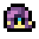

<div align="center">

# 🌱 Fields of Mistria Gift Guide

### Never guess a gift again.
**A fast, searchable gift guide for every villager in Fields of Mistria.**

**🔗 [Open the live guide](https://koala-08.github.io/FieldsOfMistriaGiftGuide/)**

</div>

<br>

## What is this?

The **Fields of Mistria Gift Guide** is a small, cozy web page that answers one question: *"Who wants this item?"*

Pick a category, search for an item or a villager, and instantly see who **likes** it and who **loves** it, with the villager portraits right there so you can scan at a glance instead of reading walls of text.

<div align="center">

🎁 **Liked** gives **+10** friendship &nbsp;&nbsp;&nbsp;&nbsp;
💖 **Loved** gives **+20** friendship

</div>

<br>

### Highlights

| | Feature | What it does |
|---|---|---|
| 🔎 | **Instant search** | Type an item *or* a villager name and the list filters as you type, across every category. |
| 🧑‍🌾 | **Characters tab** | Pick any villager to see everything they love and like in one place. |
| 🔗 | **Click-through navigation** | Click a villager chip to jump to their page, or click an item on their page to jump straight to it in the table. |
| 🎁 | **Liked / Loved filters** | Click the gift icons to show only liked or only loved reactions. |
| 🗂️ | **Category tabs** | Food, Animals, Forage, Artifacts, Ores &amp; Gems, Fish &amp; Insects, plus Dragon-forged. |
| 🙈 | **Spoiler-safe by default** | Late-game villagers and items stay hidden (and marked with a red `*`) until you tick **Late-game spoilers**. |
| 🎨 | **Four colour themes** | Open the colour dropdown to switch between Meadow, Harvest, Slate and Sakura, each with light and dark modes. Your choice is remembered. |
| 🌙 | **Light and dark mode** | Follows your device setting, with a toggle in the corner that remembers your choice. |
| 📱 | **Mobile friendly** | Reflows to a single column on phones, with the category tabs tucked into a dropdown. |
| 🖼️ | **Pixel portraits** | All 34 villagers and hundreds of item sprites are built right in. |

<br>

## Every villager, one glance


```
https://koala-08.github.io/FieldsOfMistriaGiftGuide/
```

> The only thing loaded from outside is the fonts (Fredoka, Nunito, Pixelify Sans) from Google Fonts. If they can't load, the guide falls back to your system fonts and still works.

<br>


## Support the project

This little guide is made with love and a lot of coffee. If it helped you charm your favorite villager, you can fuel the next update:

<div align="center">

<a href="https://www.buymeacoffee.com/Koala08">
  ☕ <b>Buy me a coffee</b>
</a>

</div>

<br>

## Get in touch

Want to help make this guide better or have any questions? Reach me on Reddit: **GamerKoala08**

<br>

## Credits and disclaimer

- **Fields of Mistria** is created by **NPC Studio**. Game art, names and characters belong to their respective owners.
- Gift preference data was compiled with help from the community [Fields of Mistria wiki](https://fieldsofmistria.wiki.gg/).
- This is an unofficial fan project and is not affiliated with or endorsed by NPC Studio.
- Game data can change between updates. If something looks out of date, open an issue or send a pull request.

<div align="center">

<br>

  

*Happy gifting, and see you in Mistria!*

</div>
