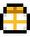
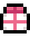

 

### Never guess a gift again.
**A fast, searchable gift guide for every villager in Fields of Mistria.**

 

**🔗 [Open the live guide](https://koala-08.github.io/FieldsOfMistriaGiftGuide/)**

 

## What is this?

The **Fields of Mistria Gift Guide** is a small, cozy web page that answers one question: *"Who wants this item?"*

Pick a category, search for an item or a villager, and instantly see who **likes** it and who **loves** it, with the villager portraits right there so you can scan at a glance instead of reading walls of text.

 &nbsp; **Liked** gives **+10** friendship &nbsp;&nbsp;&nbsp;&nbsp;
 &nbsp; **Loved** gives **+20** friendship

 

### Highlights

| | Feature | What it does |
|---|---|---|
| 🔎 | **Instant search** | Type an item *or* a villager name and the list filters as you type, across every category. |
| 🧑‍🌾 | **Characters tab** | Pick any villager to see everything they love and like in one place. |
| 🔗 | **Click-through navigation** | Click a villager chip to jump to their page, or click an item on their page to jump straight to it in the table. |
| 🎁 | **Liked / Loved filters** | Click the gift icons to show only liked or only loved reactions. |
| 🗂️ | **Category tabs** | Food, Animals, Forage, Artifacts, Ores &amp; Gems, Fish &amp; Insects, plus Dragon-forged. |
| 🙈 | **Spoiler-safe by default** | Late-game villagers and items stay hidden (and marked with a red `*`) until you tick **Late-game spoilers**. |
| 🎨 | **Four colour themes** | Open the colour dropdown to switch between Meadow, Harvest, Slate and Sakura, each with light and dark modes. Your choice is remembered. |
| 🌙 | **Light and dark mode** | Follows your device setting, with a toggle in the corner that remembers your choice. |
| 📱 | **Mobile friendly** | Reflows to a single column on phones, with the category tabs tucked into a dropdown. |
| 🖼️ | **Pixel portraits** | All 34 villagers and hundreds of item sprites are built right in. |

 

## Every villager, one glance

All **34 villagers** have their own portrait, including the late-game crew (Stillwell, Taliferro, Zorel, Caldarus, Seridia and Wheedle), who are tucked behind the spoiler toggle.

 

## What's inside

 

| Category | Entries |
|---|---:|
| 🍰 Food | 172 |
| 🌸 Forage, flowers &amp; plants | 109 |
| 🐟 Fish &amp; insects | 48 |
| 🏺 Artifacts | 38 |
| ⛏️ Ores &amp; gems | 42 |
| 🐄 Animals | 31 |
| 🐉 Dragon-forged *(late game)* | 4 |
| **Total** | **444** |

## Get in touch

Want to help make this guide better or have any questions? Reach me on Reddit: **GamerKoala08**

 

## Credits and disclaimer

- **Fields of Mistria** is created by **NPC Studio**. Game art, names and characters belong to their respective owners.
- Gift preference data was compiled with help from the community [Fields of Mistria wiki](https://fieldsofmistria.wiki.gg/).
- This is an unofficial fan project and is not affiliated with or endorsed by NPC Studio.
- Game data can change between updates. If something looks out of date, open an issue or send a pull request.

 

    

*Happy gifting, and see you in Mistria!*

